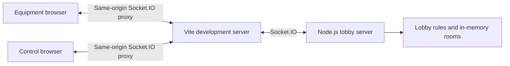

# Below the Surface

A two-player browser escape room for the CS 3810 AI capstone. Players work from separate equipment and control-room screens to escape a submerged research station.

The current build includes the real-time two-player lobby and two playable puzzles, Restore Power and Drain the Airlock. The four-puzzle plan alternates primary controls so each player operates two systems. The transmitter and hatch puzzles are future milestones. Difficulty will be increased after the initial flow is built.

## Run locally

Requires Node.js 24 or later and npm.

```bash
npm ci
npm run dev
```

Open http://localhost:5173. This command starts Vite on port 5173 and the Node.js lobby server on port 3001. Vite proxies Socket.IO traffic to the lobby server. Both ports must be available. Stop both processes with Ctrl+C.

For two players on one laptop, open the URL in a regular browser window and a private window, or use two different browsers. Each browser tab stores its private reconnect credential in sessionStorage. Duplicating an existing tab can copy that credential and reclaim the original player's seat, so use a fresh browser session for the second player.

The default setup runs locally. Public hosting and access from other devices require a deployment configuration. The backend binds to loopback. If changing the frontend origin, set CLIENT_ORIGIN on the server to its exact origin and adjust the Vite proxy target if the backend port changes. Public deployment requires HTTPS/WSS and a proxy that forwards Socket.IO traffic.

## Lobby walkthrough

1. In the first browser, choose **Create a room** and note the six-character code.
2. In the second browser, enter that code and choose **Join room**.
3. Choose **Equipment operator** in one browser and **Control room analyst** in the other. A claimed role becomes unavailable to the partner.
4. Choose **Ready up** in both browsers. **Enter station** becomes available only when both players have roles, are connected, and are ready.
5. Refresh one browser. Its seat and role return, and its ready status resets. Mark it ready again.
6. Choose **Enter station**. The operator sees four breaker switches. The analyst sees a wiring diagram and a damaged-circuit warning.
7. Choose **Leave room** to release the seat. The remaining player returns to the lobby.

A third player receives a room-full message. Invalid codes produce a readable error. A disconnected seat is reserved for five minutes. A room expires after thirty minutes without an accepted state change. Restarting the backend clears all rooms. A reconnect then returns the player to room entry with an expiration message.

## First puzzle walkthrough

The analyst guides the operator through **Tide → Anchor → Beacon**, leaving **Coil** off. The order is fixed in this initial version. Each correct activation energizes a circuit. Activating the wrong breaker trips the panel and disables further breaker input until the operator chooses **Reset panel**. Reset clears all partial progress while keeping both players in the room.

Only the equipment operator can activate or reset breakers. The analyst's sequence and damage warning are sent only to that role. Both views show the shared panel status. Controls pause while a partner is disconnected. Refreshing either browser restores the current puzzle progress. After the final correct breaker, both players see the power-restored outcome. Further puzzle actions are locked. Choose **Continue to airlock** to begin the pressure puzzle. Either player can continue once both are connected. Leaving returns the remaining player to the lobby for a new run.

Puzzle requests include a unique action ID and the expected panel version. The server ignores exact repeats of accepted actions and rejects stale versions or reused IDs with different payloads. A room retains at most 1,024 accepted puzzle actions per run. Starting a new run clears that history.

## Second puzzle walkthrough

Responsibilities swap. The control room gets **Intake**, **Bypass**, and **Return** valve controls plus the drain pump. The equipment room gets two pressure gauges and their safe range. Each player supplies information the other needs.

The gauges start at 80/20 kPa. Both must read 45–55 kPa before the pump can run. Opening Intake changes the pressures to 60/30. Opening Bypass as well produces 50/50. Leave Return closed, then choose **Start drain pump**. An unsafe pump attempt displays an interlock error and preserves the state. Valves can be opened or closed, and **Reset valves** restores the initial configuration while keeping power restored. A temporary disconnect pauses controls, and refreshing either browser restores the current puzzle view.

Both players see a drainage-complete outcome. The transmitter puzzle is next to be built.

## Four-puzzle plan

| Puzzle | Equipment room | Control room |
| --- | --- | --- |
| Restore power | Operate breakers | Read wiring diagram |
| Drain the airlock | Read pressure gauges | Operate valves and pump |
| Send a distress signal — proposed | Operate transmitter | Read transmission chart |
| Release the hatch — proposed | Read status and maintenance instructions | Operate keypad and release |

## Architecture



- `src/` contains the React interface and reconnecting Socket.IO client.
- `shared/protocol.ts` defines messages and public room snapshots.
- `server/lobby.ts` owns room capacity, roles, readiness, expiration, session ownership, and authorized puzzle actions.
- `server/power.ts` implements the deterministic breaker rules and builds role-specific puzzle views.
- `server/pressure.ts` derives pressure from valve settings, enforces the pump interlock, and filters readings and controls by role.
- `server/server.ts` validates network requests, applies a per-address request limit, and sends room snapshots only to their members.
- `tests/` contains rule, transport, and browser tests.

Room codes permit joining open seats. Separate random credentials authorize seat recovery. Public snapshots omit those credentials. The server validates role ownership, puzzle versions, and allowed actions. Each connected player receives a separately filtered snapshot. In-memory storage supports one server process. State-changing lobby setters are idempotent where applicable, snapshots carry increasing revisions, and puzzle actions are deduplicated across reconnects.

## Verification

```bash
npm test
npm run build
npm run lint
npx playwright install chromium
npm run test:e2e
npm audit
```

The build checks frontend and backend TypeScript and produces frontend assets in dist. Production serving and deployment are pending. To preview the built frontend, start the backend with `CLIENT_ORIGIN=http://localhost:4173 npm run dev:server` in one terminal and run `npm run preview` in another. Stop the development backend first so port 3001 is available.

Rule tests cover capacity, role ownership, ready/start gates, private recovery, readiness reset, expiration, and room isolation. Transport tests connect actual Socket.IO clients to verify competing role claims, unauthorized actions, malformed requests, and credential-based seat recovery. Puzzle tests cover the exact solution, wrong order, damaged and repeated breakers, reset, role privacy, stale requests, duplicate actions, partner disconnection, and refresh recovery. Pressure tests also enumerate all eight valve configurations and verify reversal, safe pumping, transition gates, alternating role permissions, private views, resets, reconnects, and completion. Playwright tests exercise the lobby and both puzzles in separate Chromium contexts, reject a third player, synchronize trip/reset/completion, and check keyboard interaction and narrow-screen overflow.

Automated checks are AI-run evidence. Project-owner code review, keyboard and screen-reader review, and manual Chrome/Firefox/Safari verification remain to be recorded. The complete accessibility and security reviews described in SPEC.md remain capstone milestones.

## Capstone records

[SPEC.md](SPEC.md) defines the working scope and acceptance criteria. [PROMPT_LOG.md](PROMPT_LOG.md) records prompts, decisions, checks, and remediation. The presentation, reflection PDF, CI pipeline, and final reproducible deployment are future milestones.

The interface loads Barlow fonts from Google Fonts and falls back to Arial when unavailable. The station illustration is drawn with CSS.
