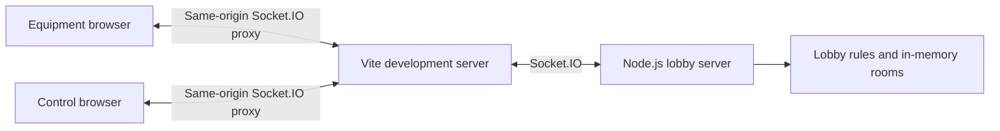

# Below the Surface

A two-player browser escape room for the CS 3810 AI capstone. Players work from separate equipment and control-room screens to escape a submerged research station.

The current milestone is a working real-time lobby. Players can create or join a room, choose distinct roles, mark themselves ready, and enter a shared briefing. Puzzle gameplay is the next milestone.

## Run locally

Requires Node.js 24 or later and npm.

```bash
npm ci
npm run dev
```

Open http://localhost:5173. This command starts Vite on port 5173 and the Node.js lobby server on port 3001. Vite proxies Socket.IO traffic to the lobby server. Both ports must be available. Stop both processes with Ctrl+C.

For two players on one laptop, open the URL in a regular browser window and a private window, or use two different browsers. Each browser tab stores its private reconnect credential in sessionStorage. Duplicating an existing tab can copy that credential and reclaim the original player's seat, so use a fresh browser session for the second player.

The default setup runs locally. Public hosting and access from other devices require a deployment configuration. The backend binds to loopback. If changing the frontend origin, set CLIENT_ORIGIN on the server to its exact origin and adjust the Vite proxy target if the backend port changes. Public deployment requires HTTPS/WSS and a proxy that forwards Socket.IO traffic.

## Lobby walkthrough

1. In the first browser, choose **Create a room** and note the six-character code.
2. In the second browser, enter that code and choose **Join room**.
3. Choose **Equipment operator** in one browser and **Control room analyst** in the other. A claimed role becomes unavailable to the partner.
4. Choose **Ready up** in both browsers. **Enter station** becomes available only when both players have roles, are connected, and are ready.
5. Refresh one browser. Its seat and role return, and its ready status resets. Mark it ready again.
6. Choose **Enter station**. Both players see the briefing with their own role.
7. Choose **Leave room** to release the seat. The remaining player returns to the lobby.

A third player receives a room-full message. Invalid codes produce a readable error. A disconnected seat is reserved for five minutes. A room expires after thirty minutes without an accepted state change. Restarting the backend clears all rooms. A reconnect then returns the player to room entry with an expiration message.

## Architecture



- `src/` contains the React interface and reconnecting Socket.IO client.
- `shared/protocol.ts` defines messages and public room snapshots.
- `server/lobby.ts` owns room capacity, roles, readiness, expiration, and session ownership.
- `server/server.ts` validates network requests, applies a per-address request limit, and sends room snapshots only to their members.
- `tests/` contains rule, transport, and browser tests.

Room codes permit joining open seats. Separate random credentials authorize seat recovery. Public snapshots omit those credentials. The server validates role ownership and start conditions on every action. In-memory storage supports one server process. State-changing lobby setters are idempotent where applicable, and snapshots carry increasing revisions. General action-ID deduplication remains part of future puzzle implementation.

## Verification

```bash
npm test
npm run build
npm run lint
npx playwright install chromium
npm run test:e2e
npm audit
```

The build checks frontend and backend TypeScript and produces frontend assets in dist. Production serving and deployment are pending. To preview the built frontend, start the backend with `CLIENT_ORIGIN=http://localhost:4173 npm run dev:server` in one terminal and run `npm run preview` in another. Stop the development backend first so port 3001 is available.

Rule tests cover capacity, role ownership, ready/start gates, private recovery, readiness reset, expiration, and room isolation. Transport tests connect actual Socket.IO clients to verify competing role claims, unauthorized actions, malformed requests, and credential-based seat recovery. Playwright tests exercise the lobby in separate Chromium contexts, reject a third player, restore a refreshed seat, synchronize the briefing, and check keyboard form submission and narrow-screen overflow.

Automated checks are AI-run evidence. Project-owner code review, keyboard and screen-reader review, and manual Chrome/Firefox/Safari verification remain to be recorded. The complete accessibility and security reviews described in SPEC.md remain capstone milestones.

## Capstone records

[SPEC.md](SPEC.md) defines the working scope and acceptance criteria. [PROMPT_LOG.md](PROMPT_LOG.md) records prompts, decisions, checks, and remediation. The presentation, reflection PDF, CI pipeline, and final reproducible deployment are future milestones.

The interface loads Barlow fonts from Google Fonts and falls back to Arial when unavailable. The station illustration is drawn with CSS.
