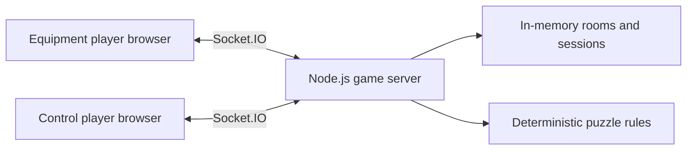

# Co-op Escape Room

## Purpose and status

Build a two-player browser escape room for the CS 3810 Applied Generative AI capstone, primarily under Track A, Web Design & Interactive Applications. Players receive different information and must communicate to escape a submerged research station.

This is the initial specification, dated November 16, 2026. The browser platform, co-op concept, and React stack were discussed with the project owner. The underwater setting, puzzle rules, recovery policy, and scope below are working proposals to review during development. The current build includes the two-player lobby, Restore Power, Drain the Airlock, and Send a Distress Signal. The final hatch puzzle remains pending. The project owner expanded the plan to four puzzles so each player operates two systems. Difficulty increases are deferred until the complete initial flow is playable.

## Players and experience

Two players open the website on separate devices. One creates a room and shares a short room code. The second joins, and the players take the equipment and control-room roles. Each player sees information and controls specific to their role.

The intended first playthrough lasts approximately 5–10 minutes. Players communicate in person or through a voice call they arrange. The experience uses a 2D illustrated control-panel interface with keyboard-operable controls. Mistakes produce feedback and allow another attempt. Completion of one puzzle unlocks the next.

## Initial scope

- One station scenario with four sequential puzzles, alternating the primary operating player.
- Two players per room, with one seat per role.
- Room creation, joining, role selection, ready status, and starting a session.
- Server-validated actions and role-specific state updates.
- Recovery after temporary disconnection or browser refresh.
- A shared escape outcome and an option to replay after both players agree.
- Responsive layouts, with desktop and laptop play as the primary demo target and usable controls on narrow screens.

Accounts, matchmaking, built-in voice chat, additional rooms, 3D movement, and AI-generated puzzles are deferred beyond the initial scope. A countdown is also deferred while puzzle difficulty is evaluated.

## Puzzle design

### 1. Restore power

The equipment player operates four breakers labeled with distinct symbols and text names. The control player receives a wiring diagram and instructions identifying a damaged breaker and the safe activation order. Activating an incorrect breaker trips the panel and gives both players clear feedback. The equipment player can reset and retry. The correct sequence restores power and unlocks the pressure system.

The initial implemented sequence is Tide → Anchor → Beacon. Coil is the damaged breaker and stays off. The operator sees all four labeled switches. Only the analyst receives the ordered feed diagram and damaged-circuit warning. Any incorrect breaker, including a repeated activation, trips the panel. Already-energized breakers are disabled in the operator UI. Reset clears partial progress and returns the panel to active status. Completion locks the panel and shows both players a power-restored outcome.

This fixed sequence is an implementation choice for the first playable version and remains open to playtesting. Puzzle actions require the equipment role, an active session, and both players connected. They carry an action ID and expected puzzle version. Accepted IDs survive reconnects and resets within a run, exact repeats return the latest snapshot, stale versions are rejected, and reused IDs with different input are rejected. Leaving or seat expiration returns the remaining player to the lobby and clears puzzle progress. A temporary disconnect preserves progress. Tests cover the solution, incorrect actions, reset, role filtering, and replay protection.

### Balanced player responsibilities

| Puzzle | Primary controls | Partner information | Status |
| --- | --- | --- | --- |
| 1. Restore power | Equipment room | Control-room wiring diagram | Implemented |
| 2. Drain the airlock | Control room | Equipment-room pressure gauges | Implemented |
| 3. Send a distress signal | Equipment room | Control-room transmission chart | Implemented |
| 4. Release the hatch | Control room | Equipment-room status and maintenance instructions | Proposed |

Room identities stay the same throughout the game. Operating and guiding responsibilities alternate. Both players participate in every puzzle, and each has the primary controls in two. The transmitter follows the alternating split. The revised hatch interaction below remains a working proposal selected to satisfy the requested balance.

### 2. Drain the airlock

After restoring power, either player can select Continue to airlock once both are connected. This transition is idempotent and cannot happen before power is restored. The control-room player operates Intake, Bypass, and Return valves and the drain pump. The equipment-room player receives both numerical gauges and the safe range. Valve settings are private to the control-room view, and readings and the safe range are private to the equipment-room view.

The initial chamber pressures are 80 and 20 kPa. The safe range is inclusive from 45 to 55 kPa for both chambers. Opening Intake changes A by −20 and B by +10. Opening Bypass changes A by −10 and B by +20. Opening Return changes A by +15 and B by −15. Closing a valve reverses its contribution. Readings are derived from the initial values plus the open valves, so each of the eight configurations is bounded and reversible. There is no time-based pressure drift.

The initial solution is Intake and Bypass open, Return closed, producing 50/50 kPa. Only the control-room player can start the pump, and unsafe readings cause an interlock error without changing the puzzle. Reset valves closes all valves and restores 80/20 without affecting completed power progress. A valid pump action completes the puzzle and locks further changes. Either connected player can then choose Continue to transmitter.

The pressure puzzle uses the same role authorization, partner-connection gate, action-ID history, version checks, and filtered snapshots as power. Refresh preserves progress, temporary disconnect pauses controls, and leaving or seat expiration clears the run. Difficulty will be revisited after the initial four-puzzle flow is built.

### 3. Send a distress signal

After draining the airlock, either player can continue to the transmitter. Equipment operates the radio. Control receives a private chart of Maintenance, Rescue, and Supply services with a frequency, antenna direction, and four-digit signal code for each. Control is instructed to use Rescue for evacuation. Equipment receives only its own applied settings and the shared transmission outcome.

The initial Rescue settings are 5.6 MHz, west, and code 7314. Other chart entries are Maintenance at 4.2 MHz/north/1042 and Supply at 6.8 MHz/east/2691. These are fictional game settings selected for the first version. Frequency choices are 4.2, 5.6, and 6.8 MHz, and antenna directions are north, east, south, and west. Codes must contain exactly four digits. Initial settings are 4.2 MHz, north, and an unset code.

Equipment edits a form and selects Apply settings to save all three values together. Transmit applied settings sends the last accepted configuration. An incorrect transmission produces a shared No acknowledgment outcome and permits retuning or resetting. A correct transmission receives a shared rescue acknowledgment and locks the controls. Reset radio returns to the initial configuration without losing power or drainage progress. Applied settings survive refresh. Form edits that have not been applied are local drafts.

The puzzle uses the existing role, connection, version, and action-ID checks. Only Equipment can tune, reset, or transmit. Neither role receives the other role's private view. Stage transitions now name their destination. A repeated or delayed transition to an earlier stage returns the current snapshot, and a premature transition is rejected. Requests from older clients without a destination retain the original transition to pressure, preventing a late request from advancing a newer puzzle.

Completion authorizes the future hatch stage. The final hatch interaction remains pending. Difficulty increases remain deferred.

### 4. Release the hatch

Proposed final system. The control-room player operates the hatch keypad and release controls. The equipment-room player reads local status symbols and maintenance instructions to guide the release procedure. After the procedure, both players arm their side and the control-room player releases the hatch. Both receive the escape outcome.

Define the symbol mapping, keypad procedure, and arming rules before implementation. Incorrect input must produce feedback and allow recovery. The server must prevent release before power, drainage, transmission, and both arming steps are complete.

## User stories and acceptance criteria

| ID | User story | Acceptance criteria |
| --- | --- | --- |
| AC-01 | As a host, I can invite a partner. | Creating a room displays a code. Joining with that code connects the second player to the same lobby. Invalid, full, or expired rooms produce a clear message. |
| AC-02 | As a player, I can take a role and start with my partner. | Each role has one occupant. Concurrent requests for the same role yield one owner. Starting requires both roles to be occupied and ready. |
| AC-03 | As a player, I receive my role's information. | The server sends only the clues and controls available to the player's current role and phase. Another room cannot receive this room's state. |
| AC-04 | As a team, we can solve the power puzzle. | The documented solution advances the phase. Incorrect input trips the panel. Reset restores its initial puzzle state without losing the room. |
| AC-05 | As a team, we can solve the pressure puzzle. | Valve actions follow the documented effects. The control-room player operates valves and pump while the equipment-room player reads private gauges. Pump activation succeeds only when both chambers satisfy the safe ranges. |
| AC-06 | As a team, we can escape. | After the distress signal, the documented hatch procedure and both arming steps enable release from the control room. Both players receive the completion state. Early release requests are rejected. |
| AC-07 | As a player, my browser stays synchronized. | Valid actions update both connected players' appropriate views without refreshing. Concurrent or repeated actions cannot bypass phase requirements or apply one accepted action twice. |
| AC-08 | As a disconnected player, I can return. | Refresh or a temporary disconnect allows the same browser to reclaim its seat using a private session credential. A fresh state snapshot restores the correct view. The partner sees connection status. |
| AC-09 | As a keyboard or screen-reader user, I can play. | All controls have accessible names, visible focus, and keyboard operation. Status changes are announced appropriately. Clues convey meaning through text or symbols in addition to color. |
| AC-10 | As a reviewer, I can reproduce the demo. | The README documents installation, starting client and server, automated checks, and a two-browser walkthrough from room creation to escape. |
| AC-11 | As a team, we can send a distress signal. | The equipment-room player operates the transmitter using the control-room player's private chart. Correct transmission unlocks hatch preparation. |
| AC-12 | As either player, I get to operate two puzzles. | Equipment has primary controls in puzzles 1 and 3. Control has primary controls in puzzles 2 and 4. The partner supplies necessary information in every puzzle. |

## Architecture

- React and TypeScript render the browser interface. Vite provides development and production builds.
- A Node.js server using TypeScript and Socket.IO owns room membership, roles, puzzle state, and transitions.
- Shared TypeScript message definitions describe client actions and server responses. Runtime validation checks incoming data because TypeScript types do not validate network input.
- Puzzle rules remain independent of transport and UI so they can be tested directly.
- The browser requests actions. The server checks session ownership, role, phase, and payload before changing state.
- The server produces a filtered view for each role. Private clues stay on the server until that role needs them.
- Each accepted state change receives an increasing revision. Action identifiers support duplicate detection within a session, and reconnecting clients receive a current snapshot.

Initial room storage is in memory. Proposed recovery reserves a disconnected seat for five minutes and expires rooms after thirty minutes of inactivity. Server restart ends active sessions and should produce a clear recovery message. Durable saves and multi-server scaling are deferred. These timing values need confirmation through playtesting.

## Security and accessibility

- Generate unpredictable room codes and separate private session credentials. A room code permits joining an available seat, while reclaiming an occupied seat requires its credential.
- Enforce capacity and role ownership on the server, including simultaneous join attempts.
- Validate message types, values, sizes, and allowed actions. Limit room creation, join attempts, and action rates.
- Restrict production origins, use HTTPS/WSS for public hosting, and keep credentials out of logs and Git.
- Review dependency vulnerability findings and asset licenses, recording remediation or justification.
- Target WCAG 2.1 AA for the app interface. Verify contrast, keyboard navigation, focus management, reduced motion, and status announcements with automated checks and manual review.

## Validation plan

Follow the assignment's test-driven validation requirement by writing meaningful rule and failure-case tests before their corresponding implementation.

1. Unit tests verify each puzzle's solution, invalid moves, reset behavior, and phase transitions.
2. Server integration tests verify room isolation, capacity, role ownership, unauthorized actions, malformed messages, duplicates, and reconnect behavior.
3. Two-browser end-to-end tests verify the full playthrough, simultaneous role selection, and refresh recovery.
4. Run build, lint, dependency scanning, and relevant automated tests in CI. Add automated accessibility checks and manually inspect keyboard and screen-reader behavior.
5. Manually play through in current Chrome, Firefox, and Safari. Record tested versions and any limitations.
6. The project owner reviews AI-generated changes, runs verification, and records findings and decisions. AI-run checks alone do not establish human verification.

## AI tooling and workflow

Codex is the coding assistant used so far, with terminal tools for scaffolding, dependency installation, and verification. Record actual model identifiers and additional tools when known. Autonomous multi-agent work has not been used in this chat.

Use SPEC.md as the scope reference and PROMPT_LOG.md as the chronological record. Before implementation, establish repository agent instructions covering architecture boundaries, validation commands, and log maintenance. Provide agents with the relevant acceptance criteria, current files, and expected checks for each bounded task.

For each generation or remediation task, record the prompt or transcript location, context provided, output, verification, human review status, and unresolved issues. Preserve representative raw or sanitized transcripts for the reflection appendix. Tag primarily AI-generated commits with [AI-assisted]. Capture genuine bugs and remediation as they occur for the two required reflection case studies.

## Milestones and capstone packaging

1. Review this specification and establish agent instructions and validation tooling.
2. Implement and verify the two-player lobby and server-owned session lifecycle.
3. Implement each puzzle with its rule tests and role-specific views.
4. Verify the complete playthrough, reconnect behavior, security boundaries, accessibility, and browser support.
5. Provide reproducible run commands, an architecture diagram, verification evidence, and a demo walkthrough in the README. Select and document hosting if a public demo is desired.
6. Prepare the 4–6 page reflection PDF with tooling, workflow, two actual failure/remediation case studies, human oversight, and a representative prompt/transcript appendix.
7. Prepare the ten-minute presentation covering the problem, architecture, live demo, agent workflow, and engineering lessons.

The final submission includes the private GitHub repository, working technical artifact, reproducible execution evidence, presentation, and reflection PDF.
