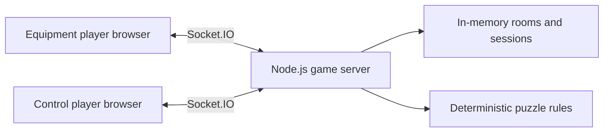

# Co-op Escape Room

## Purpose and status

Build a two-player browser escape room for the CS 3810 Applied Generative AI capstone, primarily under Track A, Web Design & Interactive Applications. Players receive different information and must communicate to escape a submerged research station.

This is the initial specification, dated November 16, 2026. The browser platform, co-op concept, and React stack were discussed with the project owner. The underwater setting, puzzle rules, recovery policy, and scope below are working proposals to review during development. The repository currently contains the Vite React starter. Game functionality is pending.

## Players and experience

Two players open the website on separate devices. One creates a room and shares a short room code. The second joins, and the players take the equipment and control-room roles. Each player sees information and controls specific to their role.

The intended first playthrough lasts approximately 5–10 minutes. Players communicate in person or through a voice call they arrange. The experience uses a 2D illustrated control-panel interface with keyboard-operable controls. Mistakes produce feedback and allow another attempt. Completion of one puzzle unlocks the next.

## Initial scope

- One station scenario with three sequential puzzles.
- Two players per room, with one seat per role.
- Room creation, joining, role selection, ready status, and starting a session.
- Server-validated actions and role-specific state updates.
- Recovery after temporary disconnection or browser refresh.
- A shared escape outcome and an option to replay after both players agree.
- Responsive layouts, with desktop and laptop play as the primary demo target and usable controls on narrow screens.

Accounts, matchmaking, built-in voice chat, additional rooms, 3D movement, and AI-generated puzzles are deferred beyond the initial scope. A countdown is also deferred while puzzle difficulty is evaluated.

## Puzzle design

### 1. Restore power

The equipment player operates four breakers labeled with distinct symbols and text names. The control player receives a wiring diagram and instructions identifying a damaged breaker and the safe activation order. Activating an incorrect breaker trips the panel and gives both players clear feedback. The equipment player can reset and retry. The correct sequence restores power and unlocks the pressure system.

Before implementation, define the exact sequence, diagram, and trip rules together so the instructions lead to a reproducible solution. Unit tests must cover the solution, incorrect actions, and reset behavior.

### 2. Drain the airlock

The equipment player operates labeled valves. The control player sees the two chamber pressure readings, safe ranges, and pump status. Valve changes affect both chambers according to deterministic rules. When both readings enter their safe ranges, the equipment player can activate the pump and complete the puzzle.

Before implementation, define valve effects, initial pressure, limits, and safe ranges. Verify that a reachable solution exists, that an unsuccessful attempt can recover, and that the control player has enough information to guide their partner. Pressure changes occur when players act, avoiding a dependence on rapid input.

### 3. Release the hatch

The equipment player reads the hatch's status symbols. The control player uses a manual to identify the corresponding release procedure. Players complete the procedure and arm their respective release controls. Once both sides are armed, either player can activate the final release and both see the escape outcome.

Before implementation, define the symbol mapping and procedure. Incorrect input must provide feedback. The server must prevent release before the preceding puzzles and both arming steps are complete.

## User stories and acceptance criteria

| ID | User story | Acceptance criteria |
| --- | --- | --- |
| AC-01 | As a host, I can invite a partner. | Creating a room displays a code. Joining with that code connects the second player to the same lobby. Invalid, full, or expired rooms produce a clear message. |
| AC-02 | As a player, I can take a role and start with my partner. | Each role has one occupant. Concurrent requests for the same role yield one owner. Starting requires both roles to be occupied and ready. |
| AC-03 | As a player, I receive my role's information. | The server sends only the clues and controls available to the player's current role and phase. Another room cannot receive this room's state. |
| AC-04 | As a team, we can solve the power puzzle. | The documented solution advances the phase. Incorrect input trips the panel. Reset restores its initial puzzle state without losing the room. |
| AC-05 | As a team, we can solve the pressure puzzle. | Valve actions follow the documented effects. Pump activation succeeds only when both chambers satisfy the safe ranges. |
| AC-06 | As a team, we can escape. | The documented hatch procedure and both arming steps enable release. Both players receive the completion state. Early release requests are rejected. |
| AC-07 | As a player, my browser stays synchronized. | Valid actions update both connected players' appropriate views without refreshing. Concurrent or repeated actions cannot bypass phase requirements or apply one accepted action twice. |
| AC-08 | As a disconnected player, I can return. | Refresh or a temporary disconnect allows the same browser to reclaim its seat using a private session credential. A fresh state snapshot restores the correct view. The partner sees connection status. |
| AC-09 | As a keyboard or screen-reader user, I can play. | All controls have accessible names, visible focus, and keyboard operation. Status changes are announced appropriately. Clues convey meaning through text or symbols in addition to color. |
| AC-10 | As a reviewer, I can reproduce the demo. | The README documents installation, starting client and server, automated checks, and a two-browser walkthrough from room creation to escape. |

## Architecture

- React and TypeScript render the browser interface. Vite provides development and production builds.
- A Node.js server using TypeScript and Socket.IO owns room membership, roles, puzzle state, and transitions.
- Shared TypeScript message definitions describe client actions and server responses. Runtime validation checks incoming data because TypeScript types do not validate network input.
- Puzzle rules remain independent of transport and UI so they can be tested directly.
- The browser requests actions. The server checks session ownership, role, phase, and payload before changing state.
- The server produces a filtered view for each role. Private clues stay on the server until that role needs them.
- Each accepted state change receives an increasing revision. Action identifiers support duplicate detection within a session, and reconnecting clients receive a current snapshot.

Initial room storage is in memory. Proposed recovery reserves a disconnected seat for five minutes and expires rooms after thirty minutes of inactivity. Server restart ends active sessions and should produce a clear recovery message. Durable saves and multi-server scaling are deferred. These timing values need confirmation through playtesting.

## Security and accessibility

- Generate unpredictable room codes and separate private session credentials. A room code permits joining an available seat, while reclaiming an occupied seat requires its credential.
- Enforce capacity and role ownership on the server, including simultaneous join attempts.
- Validate message types, values, sizes, and allowed actions. Limit room creation, join attempts, and action rates.
- Restrict production origins, use HTTPS/WSS for public hosting, and keep credentials out of logs and Git.
- Review dependency vulnerability findings and asset licenses, recording remediation or justification.
- Target WCAG 2.1 AA for the app interface. Verify contrast, keyboard navigation, focus management, reduced motion, and status announcements with automated checks and manual review.

## Validation plan

Follow the assignment's test-driven validation requirement by writing meaningful rule and failure-case tests before their corresponding implementation.

1. Unit tests verify each puzzle's solution, invalid moves, reset behavior, and phase transitions.
2. Server integration tests verify room isolation, capacity, role ownership, unauthorized actions, malformed messages, duplicates, and reconnect behavior.
3. Two-browser end-to-end tests verify the full playthrough, simultaneous role selection, and refresh recovery.
4. Run build, lint, dependency scanning, and relevant automated tests in CI. Add automated accessibility checks and manually inspect keyboard and screen-reader behavior.
5. Manually play through in current Chrome, Firefox, and Safari. Record tested versions and any limitations.
6. The project owner reviews AI-generated changes, runs verification, and records findings and decisions. AI-run checks alone do not establish human verification.

## AI tooling and workflow

Codex is the coding assistant used so far, with terminal tools for scaffolding, dependency installation, and verification. Record actual model identifiers and additional tools when known. Autonomous multi-agent work has not been used in this chat.

Use SPEC.md as the scope reference and PROMPT_LOG.md as the chronological record. Before implementation, establish repository agent instructions covering architecture boundaries, validation commands, and log maintenance. Provide agents with the relevant acceptance criteria, current files, and expected checks for each bounded task.

For each generation or remediation task, record the prompt or transcript location, context provided, output, verification, human review status, and unresolved issues. Preserve representative raw or sanitized transcripts for the reflection appendix. Tag primarily AI-generated commits with [AI-assisted]. Capture genuine bugs and remediation as they occur for the two required reflection case studies.

## Milestones and capstone packaging

1. Review this specification and establish agent instructions and validation tooling.
2. Implement and verify the two-player lobby and server-owned session lifecycle.
3. Implement each puzzle with its rule tests and role-specific views.
4. Verify the complete playthrough, reconnect behavior, security boundaries, accessibility, and browser support.
5. Provide reproducible run commands, an architecture diagram, verification evidence, and a demo walkthrough in the README. Select and document hosting if a public demo is desired.
6. Prepare the 4–6 page reflection PDF with tooling, workflow, two actual failure/remediation case studies, human oversight, and a representative prompt/transcript appendix.
7. Prepare the ten-minute presentation covering the problem, architecture, live demo, agent workflow, and engineering lessons.

The final submission includes the private GitHub repository, working technical artifact, reproducible execution evidence, presentation, and reflection PDF.
